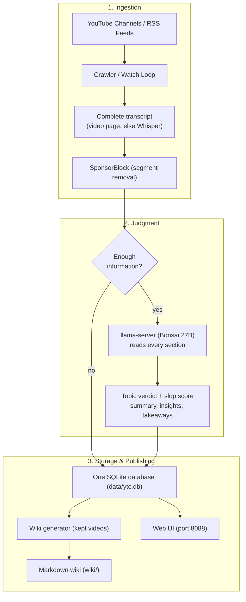

# 📚 YT-Wikinator — Autonomous YouTube Librarian & Knowledge Wiki Creator

[](LICENSE)
[]()
[](https://www.rust-lang.org/)
[](https://www.python.org/)
[](https://github.com/PrismML-Eng/llama.cpp)
[](#-privacy-what-leaves-your-machine)

> **Keep the videos that carry information. Drop clickbait, padding and engagement farming.**  
> **YT-Wikinator** watches the YouTube channels you track. For each new video it gets the transcript of the whole video (the transcript YouTube shows on the video page first, local Whisper when there is none or it stops early), removes the segments SponsorBlock users have marked, and has a local 27B parameter LLM read the entire transcript. The model judges the topic and, separately, the quality. Kept videos are compiled into an Obsidian-style Markdown wiki with `[[wikilinks]]`.  
>  
> **Hardware:** the default model `Ternary-Bonsai-2-27B-PTQ1_0` (ternary weights) is a **5.95 GB model file; it needs an 8 GB card**. The setup check asks for at least 7.5 GB of VRAM. Measured on an RTX 4070 Laptop GPU (8,188 MiB as `nvidia-smi` reports it): about 7,020 MiB in use with the model loaded, and a peak of 7,441 MiB while GPU Whisper ran next to it.

---

## 🏛️ Why This Exists

YouTube is the Library of Alexandria of our time: lectures, repair guides, whole courses and first-hand knowledge on almost any subject. Its shelves are filling up with AI slop, though: videos made in bulk that take your time and carry little information. Finding the videos that are worth your time means zapping through hundreds that are not.

YT-Wikinator does that sorting for you, for the channels and interests you choose. It is not meant to keep you off YouTube. The wiki is a catalogue, not a replacement: every entry links to its video on YouTube, and the summary is there so you can tell whether this is a video you really want to watch.

---

## 🌟 How a Video Is Judged

A video is **kept** when all four of these hold:

1. **The topic is acceptable.** Any subject is welcome: history, mathematics, science, cooking, any craft or field. Only three kinds of topic are rejected:
   - **fringe**: paranormal, pseudoscience, conspiracy theories, astrology, near-death experiences, UFOs and the like
   - **nonsense**: content with no intent to inform, such as pranks, pure reaction videos, noise
   - **politics**: partisan politics, elections, culture war, commentary on geopolitical conflicts
2. **The quality is good enough.** The model gives a **slop score** from 0 to 100. It measures quality only: information density, substance and concrete detail against clickbait, padding and engagement bait. The subject never raises or lowers it. 0 is dense, 100 is pure slop. A video is kept up to a score of 45 (change it with `--max-slop` or the **Max Slop Score** box). The decision is stored with each video when it is analysed: a changed cutoff applies to videos analysed from then on, and stored videos keep their decision until they are re-analysed (`ytc reanalyze --all`).
3. **There is enough information.** A very short video, or one with almost no speech, cannot be judged. It is stored as **Not enough information**, not as slop. That means: fewer than 120 words in the transcript; or a video under 60 seconds with fewer than 200 words; or fewer than 10 words per minute with fewer than 300 words in total.
4. **You did not disqualify it.** See [Removing a video by hand](#removing-a-video-by-hand).

Topic and quality are two separate answers of the model. A well-made history lecture is kept. A hyped video with no content is not. A well-produced astrology video is rejected for its topic, whatever its quality.

### Your own categories (optional)

YT-Wikinator comes without any subject categories. You can use it as it is, or define categories of your own:

```bash
./target/release/ytc category add "Baking" --description "Bread, pastry, ovens and techniques"
./target/release/ytc category add "Astronomy"
./target/release/ytc category list
./target/release/ytc category rename "Baking" "Bread and Pastry"
./target/release/ytc category describe "Astronomy" "Stars, planets, telescopes"
./target/release/ytc category remove "Astronomy"
```

The web UI has the same under **Categories…** on the Insights tab.

- Once you have categories, the model is shown their names and descriptions and assigns each video it analyses to exactly one of them, or to none. An answer that is not one of your names is stored as "no category".
- A category is only a label. The label is not used when deciding whether a video is kept. Adding or changing categories makes the model's instructions longer, though, and that can shift individual scores slightly: in a check on 39 videos with five categories, 5 scores moved and 1 keep decision changed.
- `category rename` gives a category another name; its videos follow. A name that another category already has is refused. `category describe` replaces the description the model reads; without a text the description is removed.
- Removing a category deletes no video: its videos stay in the library without a category. Its wiki page becomes stale; `ytc wiki --prune` moves it out like any other stale page. The same happens to the old page of a renamed category.
- The wiki gets one page per category that holds kept videos (`categories/<name>.md`), and the web UI gets a filter per category. Without categories there are no such pages and no such filters.

**Videos that are already analysed.** `ytc categorize` gives them a category without analysing them again:

```bash
./target/release/ytc categorize              # analysed videos that have no category
./target/release/ytc categorize --limit 50   # the same, at most 50 videos
./target/release/ytc categorize --all        # also ask again for videos the model already sorted
```

- The model gets one short request per video with the stored title, summary, key insights and topics. The transcript is not read again, so this is much faster than `ytc reanalyze`.
- Only the category changes. Score, topic verdict, keep decision and summary stay as they are.
- It covers the videos an LLM judged. Videos with only a heuristic estimate or with too little information are left out.
- Before it starts, the command prints how many videos are ahead. At the end it prints how many went into each category, how many fit none and how many failed. If the LLM is down or fails for two videos in a row, the run stops; the videos done until then keep their category.
- A video that fits none of your categories is remembered and not asked about on every run. It is asked again after you add, rename, describe or remove a category, or with `--all`.
- In the web UI: **Categories…**, then **Assign categories to existing videos**. It shows its progress and cannot run at the same time as a crawl, a discover run or a re-analysis.

**Setting a category by hand.** You can overrule the model for any analysed video:

```bash
./target/release/ytc set-category <video id or URL> "Baking"   # into this category
./target/release/ytc set-category <video id or URL> --none     # into no category
./target/release/ytc set-category <video id or URL> --auto     # the model decides again
```

- A category set by hand stays. No later analysis, re-analysis or `ytc categorize` changes it, and `--none` keeps a video out of every category in the same way. `ytc show` and `ytc export` mark it with "(set by hand)".
- The name must be one of your categories; upper and lower case do not matter. An unknown name is refused, and the error lists your categories.
- `--auto` only clears the mark. The category stays as it is until the video is analysed again or `ytc categorize --all` asks the model.
- Removing a category also clears the mark on the videos that were put into it by hand.
- In the web UI every insight has a small category dropdown with your categories, **No category** and **Automatic (model decides)**. A category chosen there is shown as "set by hand".

### The whole transcript is read

- **Complete transcript.** The video length is compared with the end of the last caption line. Captions that reach less than about 90% of the video (and end more than 20 seconds before it does) are not accepted; the next source is tried, in the end a local Whisper transcription of the full audio. How much of the video the transcript covers is stored and shown. A caption track that stops early is a last resort only: it is used, with its real coverage shown, when Whisper cannot run on this PC at all. When YouTube merely refuses the audio download for the moment (rate limit), the video is left for a later try.
- **Complete reading.** A transcript that fits one request is sent whole. A longer one is cut into consecutive sections that fit the model's context window. The model takes notes on every section (facts, claims, concrete details, signs of padding or bait), and then judges the video from the title and all notes. Nothing is sampled or skipped. Each insight shows what was read, for example `whole transcript (4 sections)`.
- **What it costs in time.** A short video takes one LLM request. A long video takes one request per section plus one for the judgment. With the default settings a section holds about 21,000 characters, so a one-hour talk (roughly 9,000 words) is about 3 sections and 4 requests. Measured on the test PC (RTX 4070 Laptop GPU, 8 GB): about 5 minutes (312 s) for a transcript of 208,000 characters read in 10 sections, and about 2 minutes (136 s) for 71,000 characters in 4 sections. A video without usable captions needs the Whisper transcription on top. Other hardware has not been measured.
- The section size follows the context window: `YTC_LLM_CONTEXT_TOKENS` (default 8192; the Control Center sets it from `llm.context_size`) and `YTC_LLM_CHARS_PER_TOKEN` (default 3.0, deliberately conservative). `YTC_LLM_CONTEXT_CHARS` fixes the characters per request directly.

### Channels

- Each channel has a **rolling slop average** over its last 5 videos whose quality the LLM judged. A channel with at least 3 such videos is muted automatically when the average is above 75, and marked high-signal at 35 or below.
- Videos that are off-topic, have not enough information, were disqualified by hand, or were scored without the LLM do **not** count in the average. A channel is never muted or demoted because of a few short videos.
- A status you set by hand (`ytc toggle-channel`, `ytc set-status`) stays until you change it.

### Other features

- **Local analysis.** Transcripts are analysed by an LLM on your own machine (`127.0.0.1` by default). No API key is needed. Some data does leave the machine, mainly to YouTube; see [Privacy](#-privacy-what-leaves-your-machine).
- **SponsorBlock.** Segments the SponsorBlock community has submitted for a video (sponsor, self-promotion, interaction reminders, intro, outro, filler) are cut out before analysis. Nothing is detected locally.
- **Heuristic fallback.** When no LLM endpoint is configured, `ytc` scores a transcript with a built-in heuristic. That is a rough word-count estimate with no understanding of the content. (When an LLM is configured but not reachable, videos are left pending instead.) Its results are marked `heuristic`, carry no topic verdict, and do not count in channel averages. Re-analyse them once the LLM runs: `ytc reanalyze --analyzer heuristic`.
- **Markdown wiki.** Insight pages, topic pages, creator pages and, when you have defined categories, one page per category.
- **Web UI.** Built-in web server on port 8088: search, category filter and category management, channel health, crawl control, remove and restore videos.

---

## 🔬 How Good Is the Local Model?

The local model is small: 27B parameters packed into a 5.95 GB file, running on an 8 GB graphics card. To see whether its judgments can be trusted, they were compared with those of a much larger model, Claude Fable 5.2. Both read the full transcript of the same videos with the same scoring rules, and neither saw the other's result. Fable 5.2 is a strong second opinion here, not ground truth.

| Sample | Same keep / drop decision | Local model keeps, Fable drops | Local model drops, Fable keeps | Rank correlation of scores |
|---|---|---|---|---|
| 21 videos of mixed length | 15 of 21 | 6 | 0 | 0.75 |
| 79 shorter videos | 54 of 79 (68%) | 24 | 1 | 0.84 |

In short:

- **Clear cases are judged the same way.** Dense videos get low scores from both, empty ones get high scores from both.
- **The local model is generous in the middle.** Videos that Fable 5.2 finds thin are often kept. It almost never drops a video Fable 5.2 would keep.
- **A stricter cutoff helps.** On 39 videos set aside for checking, a cutoff of 34 instead of 45 raised agreement from 27 to 31 of 39. It also dropped 8 videos Fable 5.2 would have kept.

The samples are small, so treat the figures as indicative. For anything that slips through, use [Removing a video by hand](#removing-a-video-by-hand).

---

## 🏗️ System Architecture



---

## ✅ Requirements

- Windows 10 or 11 (the Control Center and the setup check are Windows-only; the `ytc` command line also builds on Linux/macOS, but that is untested)
- NVIDIA graphics card with 8 GB VRAM or more, driver 551.61 or newer
- Python 3.10 or newer with Tk (the python.org installer or the Microsoft Store Python), with `pythonw.exe` on `PATH`
- [Rust](https://rustup.rs/) only if you build `ytc.exe` yourself. The setup prefers the ready-made `ytc.exe` from this project's GitHub release. That file is not code-signed, so Windows or an antivirus program may show a warning; the setup checks it against a pinned SHA-256 before using it, and you can always build it from source instead.

---

## 🚀 Quick Start (Windows) — Recommended

1. Get the code:
   ```bash
   git clone https://github.com/VRAMpoor/yt-wikinator.git
   cd yt-wikinator
   ```
2. Double-click `Create_Desktop_Shortcut.bat` once. It puts a **YTC Control Center** icon on the Desktop.
3. Double-click the icon. The Control Center runs a setup check at every start and offers to fetch what is missing:
   - the LLM engine and its CUDA runtime, into `bin/llama`
   - the base model (5.95 GB), into `models/`
   - the Python packages and the Whisper model
   - `ytc.exe`: the ready-made program of the matching GitHub release is downloaded to the app folder. If no `ytc.exe` is published for this version, or the download is not possible, it is built with `cargo` when Rust is installed. Without both, the check explains the two ways to get it.

   Every download (engine, model, `ytc.exe`) is checked against a fixed SHA-256 checksum before it is unpacked or run. A file that does not match is deleted.
4. When everything is there, the Control Center starts the LLM engine and the web server hidden. It opens `http://localhost:8088` as soon as the web server answers. The LLM engine may still be loading the model at that moment (the status line shows `LOADING MODEL` until it is ready).
5. Add a channel in the Control Center (`@handle`, URL or channel ID) and press **Crawl Selected**.

The same check works from the command line:

```bash
python ytc_setup.py              # report what is present and what is missing
python ytc_setup.py --install    # download and install everything missing
python ytc_setup.py --self-test  # built-in checks of the setup logic (no network)
```

`Launch_ControlCenter.bat` and `Start_All.bat` start the app without the icon. `Stop_All.bat` stops both services. `Open_WebUI.bat` opens the web UI on the port from `config.json` (`ytc.port`).

- **Everything is inside the app folder.** The Control Center looks for `llama-server.exe` in `bin/llama`, for the model in `models/`, and for `ytc.exe` in `target/release` and then in the app folder itself. A path in `config.json` is tried first; a relative path there means inside the app folder. No other folder on the PC is searched.
- If something does not start, the reason is in the log pane and in `logs/control_center.log`, `logs/llama-server.log` and `logs/ytc-server.log`.
- **`ytc.exe` and the launcher belong together.** The Control Center and the setup check compare what `ytc.exe --version` prints with the version of the app (0.1.0). A `ytc.exe` that does not match is reported in the setup check and in the log (`found X, need Y`), and the Control Center does not start it. If `ytc.exe --version` itself fails (for example while an antivirus program scans the file), that error is shown and nothing is said about the version; the next action asks again. To replace a `ytc.exe` that does not match: stop the web server and any crawl, press **SETUP CHECK** and use the install button, or run `python ytc_setup.py --install`. By hand: `cargo build --release`.

### In the Control Center

- **Channel list:** rolling slop, *Kept / Quality-judged*, and the videos that were not kept, counted by reason: below the quality cutoff · off-topic · not enough information · disqualified.
- **Disqualify video / Restore:** enter a video URL or ID (and a reason) to take a video out of the wiki, or to bring it back.
- **Re-analyse library...:** explains what it does and how long it can take, then runs `ytc reanalyze --analyzer heuristic` or `ytc reanalyze --all`. The output, including the `Reading section 3 of 7` lines, appears in the log. The same button stops it.

### Moving the app to another PC

The app folder is the whole app. Copy the complete folder: `data/` (your database), `models/` (the model), `bin/` (the LLM engine), `wiki/` and `config.json` travel with it.

1. Copy the folder to the other PC.
2. Run `Create_Desktop_Shortcut.bat` there again.
3. Python 3.10 or newer and a current NVIDIA driver must be installed on that PC. The setup check installs the Python packages and reports anything else that is missing.

Paths inside the app folder are stored in `config.json` as relative paths, so nothing has to be changed after the move.

---

## 📦 Manual Installation (Alternative)

Use these steps if you do not want the automatic setup. Two components are not in the repository because they are large and belong to other projects.

### 1. `llama.cpp` Inference Server (`llama-server`), PrismML Fork
- The default Bonsai `PTQ1_0` model **only runs on the PrismML fork** of llama.cpp. Stock llama.cpp rejects `PTQ1_0`.
- Download from the [PrismML-Eng/llama.cpp Releases](https://github.com/PrismML-Eng/llama.cpp/releases) (tested tag: `prism-b12128-d7b2896`): the Windows CUDA 12.4 build plus the matching `cudart` zip.
- Unzip both into `bin/llama/` so that `bin/llama/llama-server.exe` exists, or set `llm.server_binary` in `config.json`.
- With stock llama.cpp, use a standard GGUF model instead (see *Alternative Models* below).

### 2. The Base LLM Model (GGUF Format)

> [!NOTE]
> **Model file 5.95 GB; needs an 8 GB card.**  
> The default model is **Ternary-Bonsai-2-27B** (`Ternary-Bonsai-2-27B-PTQ1_0.gguf`), a 27B parameter model with ternary weights. The file alone is 5.95 GB; the context cache for 8192 tokens and the compute buffers come on top, so plan for an 8 GB card with all layers on the GPU (`-ngl 99`).  
> Measured on an RTX 4070 Laptop GPU (8,188 MiB as `nvidia-smi` reports it), read every half second; 200 MiB were already in use by Windows before the start and are included. With the model loaded: 6,996 to 7,040 MiB, also while it answered a long request. While Whisper (`base`) transcribed an 11-minute recording on the GPU next to it, two runs: peaks of 7,441 and 7,409 MiB. That leaves about 750 MiB free at the peak. Anything else that uses the card (a game, a second model) can push it over; Whisper then falls back to the CPU. Other cards are untested.

- **Download:** [`Ternary-Bonsai-2-27B-PTQ1_0.gguf` on HuggingFace](https://huggingface.co/prism-ml/Ternary-Bonsai-2-27B-gguf)
- Save the `.gguf` file as `models/Ternary-Bonsai-2-27B-PTQ1_0.gguf`.
- *Alternative Models:* Any standard instruction-tuned GGUF model (e.g. `Qwen2.5-7B-Instruct-Q4_K_M.gguf`, `Llama-3.1-8B-Instruct-Q4_K_M.gguf`) works with stock llama.cpp too. Other models are untested with the current prompts.

### Step 1: Get the Code
```bash
git clone https://github.com/VRAMpoor/yt-wikinator.git
cd yt-wikinator
```

### Step 2: Install Python Dependencies
```bash
pip install -r requirements.txt
```
- `requirements.txt` includes `nvidia-cublas-cu12` and `nvidia-cudnn-cu12`, which Whisper needs to run on the GPU. Without them Whisper still works, but on the CPU. PyTorch is not needed.
- `ytc` starts the transcript helpers with `python`. Set the environment variable `YTC_PYTHON` to the interpreter that has `requirements.txt` installed (for example a venv) if that is a different one.
- FFmpeg is not required.

### Step 3: Get `ytc.exe`
Either take the ready-made `ytc.exe` from the [releases page](https://github.com/VRAMpoor/YT-Wikinator/releases) (if one is published for your version) and put it into the app folder, or build it with the [Rust toolchain](https://rustup.rs/):
```bash
cargo build --release
```
The build writes `target/release/ytc.exe` (`target/release/ytc` on Linux/macOS).

### Step 4: Launch the Local LLM Engine

```bash
# Windows PowerShell (the model is a 5.95 GB file; needs an 8 GB card)
& "bin\llama\llama-server.exe" -m "models/Ternary-Bonsai-2-27B-PTQ1_0.gguf" -ngl 99 -c 8192 --port 8080 --host 127.0.0.1 --reasoning off

# Linux / macOS
./llama-server -m models/Ternary-Bonsai-2-27B-PTQ1_0.gguf -ngl 99 -c 8192 --port 8080 --host 127.0.0.1 --reasoning off
```
*Verify the engine is online by opening `http://127.0.0.1:8080/health` in your browser.*

If you start the engine with another context size than 8192 (`-c`), tell `ytc` with the environment variable `YTC_LLM_CONTEXT_TOKENS`, so that the transcript sections fit.

---

## 💻 Usage & Workflows

The commands below use `./target/release/ytc`; on Windows that is `target\release\ytc.exe` (or `ytc.exe` in the app folder when the setup downloaded it). The LLM engine must be running. `ytc --help` and `ytc <command> --help` describe every command.

### One database

There is exactly one lookup rule, everywhere:

1. `--db <file>` if given,
2. else the environment variable `YTC_DB`,
3. else `<app folder>/data/ytc.db`.

The app folder is the folder that contains `ytc.exe`. For a cargo build in `target/release` or `target/debug` it is the project folder two levels up. No other place is searched. If the file does not exist, it is created there. The chosen path is printed at startup. (This rule is about the database. The wiki folder is a separate setting whose default, `./wiki`, is relative to the current directory; see `--wiki-dir` under [Other Options](#other-options).)

The Control Center always passes `--db`: the file from `ytc.db_path` in `config.json` (default `data/ytc.db`, relative to the app folder). The Python scripts in `scripts/` use `--db`, else `YTC_DB`, else `<app folder>/data/ytc.db`. So all three work on the same file unless you tell them otherwise.

**Combining two libraries.** `ytc merge-db <other file>` copies the channels, videos, transcripts and insights of another YT-Wikinator database of this version into the current one, for example the library of a second PC:

```bash
./target/release/ytc merge-db "D:\second-pc\ytc.db"
```

If you use `--db`, give it here too (`ytc --db <file> merge-db <other file>`), otherwise the import goes into the default database.

`merge-db` works in one transaction, and the other file is only read. Nothing is lost: for a video present in both, the better analysis is kept (an LLM result beats a heuristic estimate; among equals the more recent one), the longer transcript is kept, and channel statuses set by hand, disqualifications and categories set by hand survive. The command prints exact counts of what was added, replaced and left as it was. Running it twice changes nothing the second time.

### 1. Ingest a Single Video
```bash
./target/release/ytc process-video "https://www.youtube.com/watch?v=AbCdEfGh123"
```
It prints the insight with topic verdict, quality score, whether the video is kept (and why not), and in how many sections the whole transcript was read. With `--json` the stored result is printed as one JSON object.

### 2. Add Channels to Track
```bash
./target/release/ytc add-channel "https://www.youtube.com/@somechannel"
./target/release/ytc add-channel "UCxxxxxxxxxxxxxxxxxxxxxx"
./target/release/ytc crawl --limit 3      # fetch and judge up to 3 new videos per channel
./target/release/ytc channel-health       # status, average and what became of each channel's videos
```

### 3. Watch Channels Around the Clock
`ytc watch` crawls all tracked channels on a timer.
```bash
# every 60 minutes, at most 2 new videos per channel
./target/release/ytc watch --interval 60 --limit 2
```

Alternative: the Python supervisor loop. It works through the pending queue one video at a time (`ytc process-video --json`, at most 30 minutes per video; a channel crawl gets the same 30 minutes for each video it may read). A video that runs into this limit stays pending and is tried again later; the script never marks a video as failed. It also slows down when YouTube rate-limits, waits when the LLM engine is not reachable, and regenerates `wiki/` as it goes. It only reads the database. It logs for each processed video what became of it (kept, below the quality cutoff, off-topic, not enough information, disqualified) and counts these groups.
```bash
python scripts/continuous_autonomous_daemon.py
```
It uses `target/release/ytc(.exe)`, else `ytc(.exe)` in the app folder, and the database from `YTC_DB`, else `data/ytc.db`. It stops with a message if either is missing.

### 4. The Web UI
```bash
./target/release/ytc serve --port 8088
```
Open `http://localhost:8088`. The header shows how many videos are kept, below the quality cutoff, off-topic, without enough information, and disqualified. Each insight shows what was read (`whole transcript (N sections)`) and where the transcript came from. `GET /api/status` returns the server's state as JSON.

### Removing a video by hand

You can take any video out of the wiki, whatever the model said.

```bash
./target/release/ytc exclude <video id or URL> --reason "duplicate of another talk"
./target/release/ytc excluded                 # list the disqualified videos
./target/release/ytc include <video id or URL>    # undo
./target/release/ytc wiki --prune             # move the pages of removed videos out of the wiki
```

- A disqualified video is never kept, also after a re-analysis. It does not count in its channel's average.
- The next wiki run stops listing it. Its page becomes stale; `ytc wiki --prune` moves stale pages into the `.ytc-pruned` folder inside the wiki folder. Nothing is deleted.
- `ytc include` hands the decision back to the stored judgment. The video is back in the library if topic, quality and amount of information allow it.
- In the web UI every insight card has a **Remove from wiki** button (with a confirmation and an Undo). The **Disqualified** filter lists the removed videos, each with a **Restore** button. Then press **Sync Wiki**: the video leaves the index and the topic pages. Its own page file stays until you run `ytc wiki --prune`; the web UI has no button for that.
- In the Control Center: the **Disqualify video** line with **Disqualify** and **Restore**.

### Re-analysing stored videos

`ytc reanalyze` runs the analysis again on stored transcripts. It makes no request to YouTube. Use it after you changed the model, or after an LLM was set up for videos that only have a heuristic estimate. (To give stored videos a category only, `ytc categorize` is much faster: see [Your own categories](#your-own-categories-optional).) Give exactly one selection:

| Selection | Videos |
|---|---|
| `<video id or URL>` | this one video |
| `--analyzer <prefix>` | every video whose analyzer type starts with the prefix, e.g. `heuristic`, `llm:` |
| `--all` | every analysed video |

`--limit N` (`-l N`) stops after N videos. Before it starts, the command prints how many videos and how many LLM requests are ahead. A stored insight is replaced only by a valid new answer. Videos disqualified by hand are skipped by the bulk selections. Videos without a stored transcript cannot be re-read; they are skipped and named. If the LLM stops answering, the run ends and the remaining videos are left unchanged.

```bash
./target/release/ytc reanalyze --analyzer heuristic   # videos that only have a heuristic estimate
./target/release/ytc reanalyze --all --limit 20       # the whole library, in portions
./target/release/ytc wiki --prune                     # then rewrite the wiki
```

A run over a large library can take hours. It can be stopped with Ctrl+C; videos finished until then keep their new result. The bulk selections (`--analyzer`, `--all`) take the videos in the order of their last analysis, the one analysed longest ago first. A run in portions with `--limit`, or a run started again after an interruption, therefore continues with the videos that were not analysed again yet.

### Other Options
- `--max-slop <n>` (environment variable `YTC_MAX_SLOP`; default 45): the quality cutoff. A video can only be kept when its slop score is at or below it. A changed cutoff applies to videos analysed from then on; stored videos keep their decision until they are re-analysed (`ytc reanalyze --all`). Library, wiki and counts therefore do not change at once when you change the number.
- `--wiki-dir <dir>` (environment variable `YTC_WIKI_DIR`; default `./wiki`): the folder the Markdown wiki is written to. Use a folder of its own: `Home.md`, `index.md` and the pages under `insights/`, `topics/`, `creators/` and `categories/` are rewritten on every run.
- Global options: `--db`, `--llm-url`, `--llm-key`, `--llm-model`, `--max-slop`, `--wiki-dir`. The short form `-d` of `--db` only works before the command, because `crawl`, `discover` and `watch` use `-d` for their delay.
- A video whose processing failed 3 times during crawls is skipped by later crawls. `ytc process-video <video id>` tries it again.
- `ytc wiki --prune`: regenerate the wiki and move stale generated pages into `.ytc-pruned`. Files that ytc did not write are never moved or overwritten.
- `ytc list`, `ytc show <video>`, `ytc search <text>`, `ytc export <video>`: look at stored insights. Each says whether a video is kept and, if not, why.
- `ytc category add|rename|describe|remove|list`, `ytc categorize [--all] [--limit N]`, `ytc set-category <video> <name>|--none|--auto`: your own categories, see [Your own categories](#your-own-categories-optional).
- `ytc discover "<query>"`: search YouTube and analyse the top results on any subject.
- `python scripts/update_single_video.py <video id>`: run the pipeline for one video and print what was stored.
- `python scripts/register_admitted_channels.py handles.txt`: add every `@handle` listed in a text file through `ytc add-channel`.
- `python scripts/channel_discovery.py --file handles.txt`: judge two recent videos of each listed channel and add the channels that pass. Candidates come from your own list or from `ytc discover`; the script does not find channels by itself.

---

## 🔒 Privacy: What Leaves Your Machine

Transcripts and their analysis stay on your machine as long as the LLM URL is local (the default is `http://127.0.0.1:8080/v1`). The program is not offline, though. These are the outside hosts it talks to and what each one receives:

| Host | When | What it receives |
|---|---|---|
| YouTube (`youtube.com` and the hosts its pages load from) | opening the video page in a browser without a window to read the transcript; direct caption requests, titles and video lengths, RSS feeds, channel video lists, resolving channels, related channels, `discover`, audio download for the Whisper fallback (yt-dlp) | video IDs, channel handles / URLs / IDs, and the search phrases you (or `watch --discover`) pass to `discover`. The browser loads the video page like any browser does, with what a page visit sends (browser type, language, screen size and the like), and it sends back the cookies YouTube set on earlier visits. These cookies are kept in `data/browser_profile`. That is a profile of its own: it is not your everyday browser profile, and no account is signed in. |
| Microsoft | whenever the browser without a window is the installed Microsoft Edge | whatever Edge sends on its own, for example when it fetches its component updates. YT-Wikinator does not switch this off and does not control it. Not measured: which hosts and what data. |
| SponsorBlock (`sponsor.ajay.app`) | once per processed video | the first 4 characters of the SHA-256 hash of the video ID (not the ID itself) |
| GitHub, Hugging Face, PyPI, crates.io | during setup; Hugging Face also on the first Whisper run if the speech model was not downloaded by the setup | ordinary download requests for the LLM engine, `ytc.exe`, the base model, the Whisper model, Python packages and (when building) Rust crates. If you run `python -m playwright install chromium` because Edge is missing, that browser is downloaded from Playwright's servers. |
| The LLM URL | every analysis | the video title, video ID and the whole transcript text. **If you point `--llm-url` / `YTC_LLM_URL` at a remote host, full transcripts are sent there.** |

Like any web request, each of these also reveals your IP address to the host. The web UI itself loads nothing from the internet.

The folder `data/browser_profile` holds the cookies and the cache of the browser without a window. It was 48 MB here after 39 videos. You can delete it while no crawl runs; it is created again on the next video.

---

## ⚙️ Configuration (`config.json`)

```json
{
  "llm": {
    "server_binary": "bin/llama/llama-server.exe",
    "model_path": "models/Ternary-Bonsai-2-27B-PTQ1_0.gguf",
    "port": 8080,
    "gpu_layers": 99,
    "context_size": 8192,
    "reasoning": false
  },
  "ytc": {
    "binary": "target/release/ytc.exe",
    "port": 8088,
    "db_path": "data/ytc.db",
    "wiki_dir": "wiki"
  },
  "crawler": {
    "search_depth": 3,
    "delay_seconds": 10,
    "max_slop_score": 45,
    "watch_interval_minutes": 60
  }
}
```

- `config.json` is read by the **Control Center** and the setup check (and for the two port numbers by `Stop_All.bat` and `Open_WebUI.bat`). The `ytc` command line never reads it; it has its own options.
- Relative paths are relative to the app folder. The Control Center stores paths inside the app folder as relative paths.
- `llm.server_binary`, `llm.model_path`, `ytc.binary`: tried first. If the file is not there, the Control Center looks in `bin/llama`, in `models/`, and in `target/release` and the app folder. Nowhere else.
- `llm.context_size`: the context window the LLM engine is started with (`-c`). The Control Center passes the same number to `ytc.exe` as `YTC_LLM_CONTEXT_TOKENS`, so the transcript sections match the engine. (Not when `YTC_LLM_URL` points to another engine.)
- `ytc.db_path`: the one database. If the file does not exist it is created there. No other place is tried. The database box shows the full path.
- `ytc.wiki_dir`: the folder the Markdown wiki is written to. Use a folder of its own.
- `crawler.max_slop_score`: the quality cutoff (the **Max Slop Score** box); it applies to videos analysed from then on, stored videos keep their decision until re-analysed. `crawler.watch_interval_minutes`: the pause between automatic crawls (**Auto-crawl every**). `crawler.search_depth` and `crawler.delay_seconds`: videos per channel and pause between videos for crawls started from the Control Center (a crawl never pauses less than 10 seconds). All are stored by **Save Preferences**.
- **Where the list of new videos comes from.** The channel's RSS feed. YouTube's feed address answers 404 or 500 for stretches of time, also for channels that exist; the crawl then reads the channel's video list with yt-dlp instead (one request, upload dates to the day only) and, if that fails too, asks the channel once more at the end. Measured in one night: between 2 and 32 of 43 feeds failed per crawl.
- **When YouTube cannot be reached at all** (no network, no name resolution), the video is not counted as failed; the crawl waits 60 seconds and goes on, and the next crawl takes the video up again.
- **Where the transcript comes from**, in this order:
  1. **The transcript button of the video page.** `fetch_browser_transcript.py` opens the video page in a real browser without a window (the installed Microsoft Edge, else Playwright's Chromium), presses YouTube's own "Show transcript" button and reads the lines the page shows. The video is not played and no account is used; the browser keeps its own cookies in `data/browser_profile` and answers YouTube's consent page with "reject all". The video length is read from the same page.
  2. **A direct transcript request** (`fetch_builtin_transcript.py`), only when the page could not be read: the Python package `playwright` is missing, or the page has changed.
  3. **Local Whisper on the audio**, when the video has no captions, when they stop before the end of the video, or when neither of the first two got through. Only this step downloads the audio.
- What to know about the transcript button:
  - It needs the Python package `playwright` (the setup check offers it).
  - Measured on two German videos: 7.0 and 6.2 seconds per transcript. Not measured: how many videos in a row YouTube allows this way.
  - The page shows start times to the second only, so SponsorBlock segments are cut to the second for these transcripts.
  - It reads YouTube's page layout. When YouTube changes the page, it can stop working until the script is updated; the direct request and Whisper then take over.
- **When YouTube refuses a direct transcript request** (HTTP 429, "IP blocked"), the program remembers it in `youtube_pacing.json` next to the database, also across restarts. YouTube publishes no limit, so the refusal is the only signal there is. From then on:
  - Direct requests rest: 30 minutes after the first refusal, twice as long after each further one in a row, at most 6 hours. The transcript button is not affected. A video that gets no transcript either way is transcribed with Whisper at once; it does not wait for the rest to end.
  - The pause between videos doubles (at least 20 seconds, at most 5 minutes) and comes down again with every direct request that gets through. For 7 days it stays above 1.5 times the pause at which the refusal came. It never goes below `crawler.delay_seconds`, and 1 to 2 irregular seconds are added to every pause.
  - A crawl always pauses at least 10 seconds between two videos, also when `crawler.delay_seconds` is smaller.
  - To forget what was learned, delete `youtube_pacing.json`.
- YouTube is asked only for a caption track in the video's own language, never for a machine translation. English and German tracks are preferred. A track in another language written in Latin script is given to the model as it is; how well the default model judges such transcripts has not been measured.
- `llm.port` and `ytc.port`: the ports the two services use.
- The Control Center's own settings win over the environment: it always passes `--db`, `--max-slop` and `--wiki-dir` to `ytc.exe`, so `YTC_DB`, `YTC_MAX_SLOP` and `YTC_WIKI_DIR` have no effect on what is started from its window. `YTC_LLM_URL` is the exception: when it is set, the Control Center leaves the LLM address to it.

---

## ⚖️ Legal Disclaimer & Fair Use

- **Unofficial Tool:** YT-Wikinator is an independent, community-driven research project. It is **not** endorsed by, affiliated with, or sponsored by YouTube, Google LLC, or Alphabet Inc. "YouTube" is a registered trademark of Google LLC.
- **Fair Use & Transformative Analysis:** YT-Wikinator analyzes publicly available content for personal research, educational evaluation, and epistemic curation under Fair Use principles (US 17 U.S.C. § 107) and European text/data mining provisions (German UrhG § 51a / § 44b).
- **No Full-Text Redistribution:** YT-Wikinator does not publish or redistribute raw audio, video, or full-text transcripts. Transcripts stay in your local database (`data/`, which is git-ignored), and no transcript text is tracked in this repository. The wiki pages contain LLM-written summaries and short quotes from the videos; keep that in mind if you share them.

---

## 📄 License

Licensed under the **Apache License, Version 2.0** (the "License"). You may not use this file except in compliance with the License. You may obtain a copy of the License in the [LICENSE](LICENSE) file or at:

[http://www.apache.org/licenses/LICENSE-2.0](http://www.apache.org/licenses/LICENSE-2.0)
